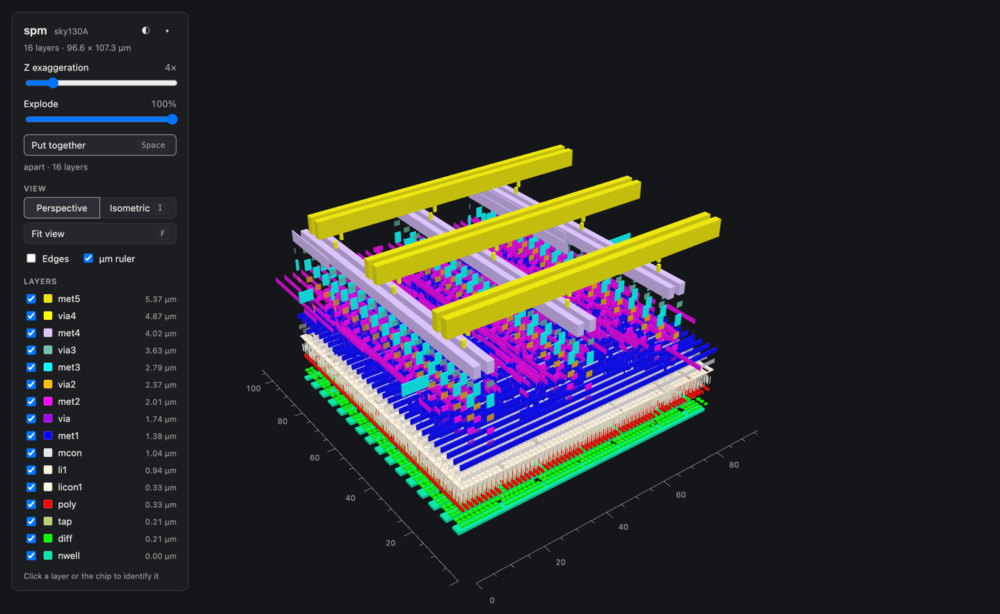
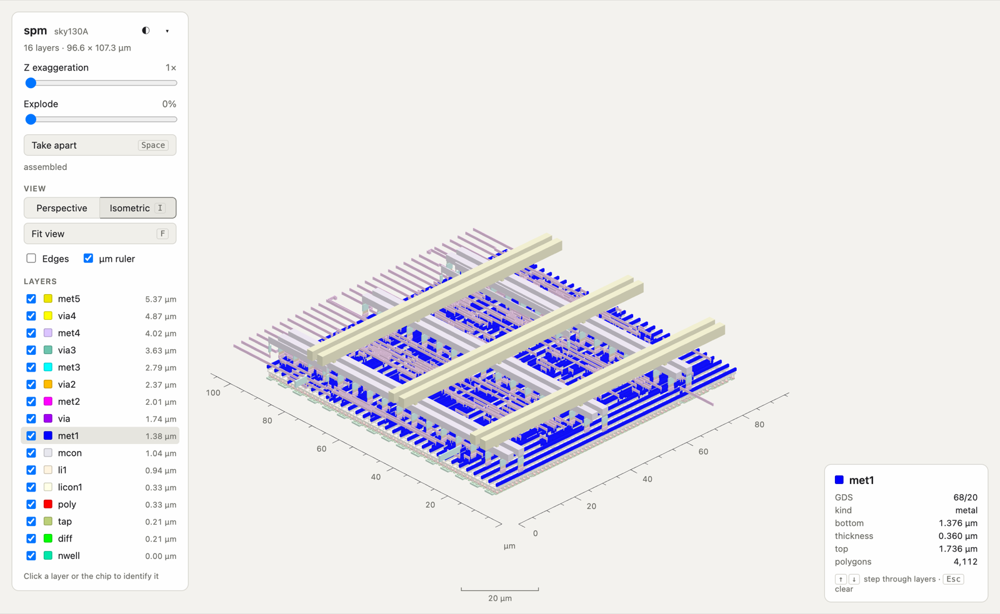

# 3D Chip Viewer

A web viewer that shows a real chip layout as a 3D stack of layers. The layers are diffusion and poly, local interconnect, five metal layers, and the vias between them.
A Python converter turns a GDSII file into a glTF model at true scale. A Three.js app lets you orbit it, take it apart layer by layer, and click any layer to identify it.

The included design is `spm`, a 32-bit serial-parallel multiplier. LibreLane runs it from RTL to GDS on the open-source SkyWater SKY130 process, and it passes DRC and LVS signoff with 0 errors.

**[Live demo →](https://antnarayan.github.io/3d-chip-viewer/)**



| | |
|---|---|
|  | **Isometric view, met1 selected.** The other layers fade back, and the card lists the layer's GDS number, height, thickness and polygon count. The ruler and scale bar are in microns. |

## Features

- **True-scale process stack.** Each layer sits at its real height and thickness from the SKY130 PDK. A z-exaggeration slider stretches the stack vertically so thin layers are easier to see.
- **Exploded view.** Press <kbd>Space</kbd> and the layers spread apart on staggered springs, top layer first. Press it again and they close back up, bottom first.
- **Click to identify.** Click the chip or a layer name to open its info card. Use <kbd>↑</kbd> and <kbd>↓</kbd> to step through the stack.
- **Views.** Switch between perspective and isometric (<kbd>I</kbd>), fit the view to the chip (<kbd>F</kbd>), and toggle edge outlines and the micron ruler.
- **Comfort.** Light and dark themes, a collapsible panel for phones, and reduced motion when the OS asks for it.

## How it works

```
spm.v ──LibreLane──▶ spm.gds ──gds2glb (Python)──▶ spm.glb ──Three.js──▶ browser
```

The converter (`converter/gds2glb/`) works in five steps:

1. **Load** (`load.py`): reads the GDS with gdstk and flattens the cell hierarchy into polygons. Paths become polygons too. Coordinates go from database units to microns once, here.
2. **Collect** (`collect.py`): groups the polygons by layer using [`layermap.json`](layermap.json). Non-geometry layers, like pin and label markers and implants, are dropped. An unmapped layer is an error rather than being silently skipped.
3. **Merge** (`merge.py`): unions each layer's overlapping polygons on a 1 nm grid, so touching shapes become one solid instead of overlapping walls.
4. **Extrude** (`extrude.py`): triangulates each polygon with earcut, holes included, then builds a top cap, a bottom cap and side walls. A check confirms the triangles cover exactly the polygon's area.
5. **Export** (`export.py`): writes one merged mesh per layer to a `.glb`, rotated from chip Z-up to glTF Y-up. The layer metadata travels inside the file as glTF `extras`. Each layer is shaved by 1 nm, so stacked layers never share a plane and flicker (z-fighting).

For `spm`, the converter turns 51,315 GDS polygons into 36,604 merged shapes and 719,360 triangles, in about 2 seconds.

The viewer (`viewer/`) is plain Vite and Three.js. It only renders while something is moving. The motion code (springs, camera glides, scale-bar rounding) is in small modules with their own unit tests.

## Layer stack

Heights and thicknesses come from SkyWater's SKY130 metal stack diagram, cross-checked against the Magic tech file. They live only in `layermap.json`, never in code.

| Layer | GDS | Bottom (µm) | Thickness (µm) |
|---|---|---|---|
| met5 | 72/20 | 5.3711 | 1.26 |
| via4 | 71/44 | 4.8661 | 0.505 |
| met4 | 71/20 | 4.0211 | 0.845 |
| via3 | 70/44 | 3.6311 | 0.39 |
| met3 | 70/20 | 2.7861 | 0.845 |
| via2 | 69/44 | 2.3661 | 0.42 |
| met2 | 69/20 | 2.0061 | 0.36 |
| via | 68/44 | 1.7361 | 0.27 |
| met1 | 68/20 | 1.3761 | 0.36 |
| mcon | 67/44 | 1.0361 | 0.34 |
| li1 | 67/20 | 0.9361 | 0.10 |
| licon1 | 66/44 | 0.3262 | 0.61 |
| poly | 66/20 | 0.3262 | 0.18 |
| diff / tap | 65/20, 65/44 | 0.2062 | 0.12 |
| nwell | 64/20 | 0.0 | 0.2062 |

## Quick start

You need Python 3.10+ and Node 22+.

```bash
python3 -m venv .venv
.venv/bin/pip install -r converter/requirements.txt
cd viewer
npm ci
npm run model   # designs/spm/spm.gds → viewer/public/models/spm.glb
npm run dev     # http://localhost:5173
```

To convert another design:

```bash
cd converter
../.venv/bin/python -m gds2glb path/to/design.gds out.glb
```

The command prints a per-layer table of polygon and triangle counts. Run it with `--help` to see options like `--top` and `--no-union`.

## Tests

```bash
cd converter && ../.venv/bin/pytest   # 49 tests
cd viewer && npm test                 # 19 tests
```

Every converter function has unit tests. For example, a 1×1 µm square must extrude to 12 triangles with a volume of 1 × thickness.
The converter is also checked against **KLayout**: for each of the 31 geometry layers in `spm.gds`, the polygon count must match KLayout's.
CI runs both test suites, rebuilds the model from the committed GDS, and deploys the viewer to GitHub Pages ([`.github/workflows/pages.yml`](.github/workflows/pages.yml)).

## Repo layout

```
converter/      Python GDS → glTF converter (gds2glb) and its tests
viewer/         Vite + Three.js web app and its tests
designs/spm/    LibreLane config, Verilog source and signed-off GDS/DEF
docs/           KLayout reference counts, screenshots
layermap.json   GDS layer/datatype → name, height, thickness, color
```

## Roadmap

- [x] LibreLane `spm` run on SKY130, clean signoff
- [x] Layer map checked against the PDK
- [x] GDS → glTF converter, verified against KLayout
- [x] Viewer: layers, exploded view, identify, isometric view, ruler, themes
- [ ] Scale to larger designs: instanced standard cells, tiling, level of detail
- [ ] DEF net highlighting, IR-drop and congestion overlays, clock-tree view

## Credits

- [SkyWater SKY130 PDK](https://github.com/google/skywater-pdk): process and layer stack
- [LibreLane](https://github.com/librelane/librelane): RTL-to-GDS flow and the `spm` example design
- [KLayout](https://www.klayout.de/): reference geometry checks
- [gdstk](https://github.com/heitzmann/gdstk), [mapbox_earcut](https://github.com/skogler/mapbox_earcut_python), [trimesh](https://github.com/mikedh/trimesh): converter
- [Three.js](https://threejs.org/): rendering
- [Anatomy](https://github.com/wheresryan22/anatomy) (MIT): inspired the staggered explode motion, selection dimming and isometric view

## License

MIT, see [LICENSE](LICENSE). The `spm` design files come from LibreLane's examples (Apache-2.0).
